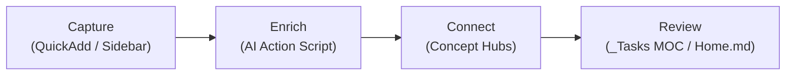
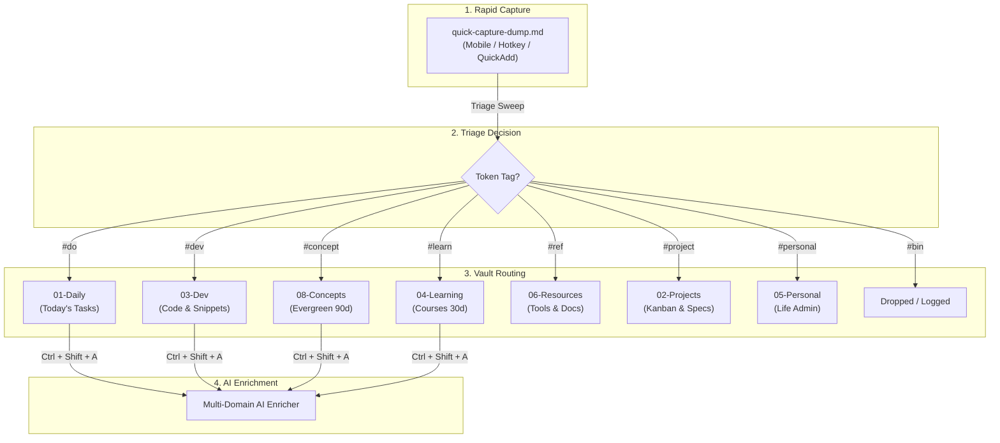
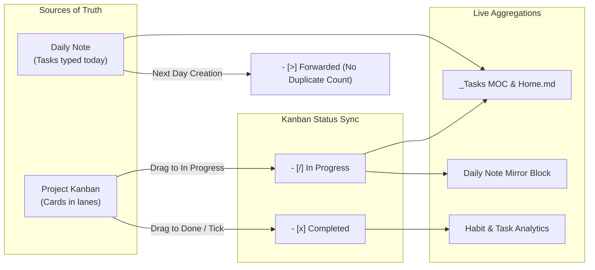

# Second Brain Guide

> Operational guide for your Obsidian vault — covering folder architecture, QuickAdd creation flows, AI enrichment, task management dashboards, concept hubs, maintenance rhythms, and vault security policies.

---

## 1. The Core Loop and Knowledge Routing

### The Core Loop: Capture → Enrich → Connect → Review



1. **Capture**: Log daily notes, dev snippets, learning items, or inbox entries with QuickAdd actions.
2. **Enrich**: Trigger `Ctrl + Shift + A` to run the **Multi-Domain AI Enricher** ([`ai-enrich-action.js`](../scripts/ai-enrich-action.js)) for summaries, reflections, code breakdowns, or domain notes.
3. **Connect**: Link concept words (`[[Fetch API]]`, `[[AI integration]]`) to populate evergreen concept notes with live Dataview backreferences.
4. **Review**: Check active tasks (`[/]`, `[ ]`) and completion histories on [`_Tasks MOC.md`](../../01-Daily/_Tasks%20MOC.md) and [`Home.md`](../../Home.md).

---

### Knowledge Routing & Triage Flow



---

## 2. Vault Folder Architecture

| Folder                   | Purpose                                  | What Goes Here                                                                                                                                                                                                                           |
| :----------------------- | :--------------------------------------- | :--------------------------------------------------------------------------------------------------------------------------------------------------------------------------------------------------------------------------------------- |
| **`Home.md`**            | Vault dashboard and entry point (file)   | HomePulse dashboard, navigation to every MOC, active in-progress items, priority to-dos, active projects, inbox status                                                                                                                   |
| **`00-Inbox/`**          | Capture everything before sorting        | Fleeting thoughts, quick captures, mobile captures, links to process later. Triage by tagging each line with a destination token, then running **Triage Sweep**. Holds `_Inbox MOC.md` + `_Triage MOC.md`. **Rule: empty this weekly**   |
| **`01-Daily/`**          | Time-stamped chronological notes & tasks | `YYYY-MM/YYYY-MM-DD.md` with `mood` / `energy` / `sleep_hours`, habit checkboxes, tasks, AI summary. Plus `_Daily MOC.md`, `_Tasks MOC.md`, and visual `Tasks Kanban.md`. *AI-enrichable*                                                |
| **`02-Projects/`**       | Outcomes with deadlines or endpoints     | One subfolder per project (project note + Kanban board), `_Projects MOC.md`. Active projects only — finished cards move to the board's own `## Archive` column, and retrospectives go to `07-Reviews/`                                   |
| **`03-Dev/`**            | Technical work & code knowledge          | Dev logs, debugging notes, architecture decisions, snippets, `_Dev MOC.md`. *AI-enrichable*                                                                                                                                              |
| **`04-Learning/`**       | Knowledge acquisition in progress        | Courses, books, tutorials, study notes, `_Learning MOC.md`. Move finished learning into `08-Concepts/` (ideas) or `06-Resources/` (reference). *AI-enrichable*                                                                           |
| **`05-Personal/`**       | Private life administration              | Health and fitness logs, finances, goals, personal journaling, `_Personal MOC.md`. Truly sensitive material belongs in `.secrets/`, not here                                                                                             |
| **`06-Resources/`**      | Reference material & automation          | Cheatsheets, manuals, how-tos, policies, `APIs/`, `clipper-templates/` (Obsidian Web Clipper JSON presets), and `scripts/` (`ai-enrich-action.js`, `weekly-ai-summary.js`). Things you *refer to* or *run* — not things you're *working on* |
| **`07-Reviews/`**        | Periodic reflection & retrospectives     | Weekly (`YYYY-[W]WW.md`) and monthly (`YYYY-MM.md`) reviews, `Habit Analytics Dashboard.md`, post-mortems, AI-generated summaries, `_Reviews MOC.md`                                                                                     |
| **`08-Concepts/`**       | Permanent atomic knowledge               | Atomic ideas, principles, mental models (`YYYY-MM-DD_HHmm {{VALUE}}`), `_Concepts MOC.md`. Each note self-contained and linked. Carries `last_reviewed` + `review_cycle: 90d`. *AI-enrichable*. *The core of your Zettelkasten*          |
| **`99-Attachments/`**    | Media and binary assets                  | Images, screenshots, PDFs, audio, exports — filed into monthly `YYYY-MM/` subfolders, plus `_Attachments MOC.md`. Keeps assets out of your note flow                                                                                     |
| **`99-Templates/`**      | Reusable note blueprints                 | `Daily.md`, `Concept.md`, `Dev.md`, `Project.md`, `Learning.md`, `Personal.md`, `Resource.md`, `API.md`, mobile capture templates. *Blueprints only — never edit these as notes*                                                         |
| **`.obsidian/`**         | Vault configuration and custom code      | HomePulse plugin (`plugins/homepulse/`), CSS snippets, themes, hotkeys, plugin settings                                                                                                                                                  |
| **`.kiro/`**             | Kiro IDE automation                      | Hooks for `.env` validation, Git safety, and inbox triage suggestions                                                                                                                                                                    |
| **`.secrets/`**          | **Git-ignored** private notes            | Bank details, private logs, credential context. Never committed                                                                                                                                                                          |
| **`.env`**               | **Git-ignored** machine credentials      | `GEMINI_API_KEY`, `OPENAI_API_KEY`. Read by the AI enricher — share `.env.example` instead                                                                                                                                               |
| **`README.md`**          | Vault documentation                      | Setup guide, conventions, plugin list — for future you or a fresh clone                                                                                                                                                                  |
| **`LICENSE`**            | Usage terms for the public repo          | MIT license — leave as-is                                                                                                                                                                                                                |

> [!NOTE] Two conventions that hold this together
> - **MOC naming**: Every folder has a `_*.md` MOC dashboard (13 in total). The leading underscore keeps MOCs out of Dataview results and AI link suggestions — don't rename them.
> - **AI enrichment scope**: `Ctrl + Shift + A` works in `01-Daily`, `03-Dev`, `04-Learning`, and `08-Concepts`. Anywhere else it declines.

---

## 3. QuickAdd Shortcuts and Triage System

### QuickAdd Action Catalog

The core QuickAdd choices required for everyday use are documented in [Setup & Configuration](Setup%20&%20Configuration.md). This catalog lists the full set of macro and template choices supported by the vault scripts:

| Choice Name                            |     Type     | Folder Target              | Naming / Function                                                                     |
| :------------------------------------- | :----------: | :------------------------- | :------------------------------------------------------------------------------------ |
| **AI Enrich Note** (`Ctrl+Shift+A`)    | Script Macro | Active Note                | Multi-domain AI summary, reflection, code explanation, or concept lore                |
| **Quick Capture**                      | Script Macro | `00-Inbox/`                | Appends timestamped line to `quick-capture-dump.md` (`quick-capture-action.js`)       |
| **Triage Sweep**                       | Script Macro | `00-Inbox/` → destinations | `triage-sweep.js` (files every tagged capture line in one pass)                       |
| **Weekly Review**                      | Script Macro | `07-Reviews/`              | `weekly-ai-summary.js` (generates weekly summary and habit statistics)                |
| **Distill Evergreen Concepts**         | Script Macro | Active Note                | Extracts atomic mental models into `08-Concepts/` with backlinks                      |
| **Start Work on Kanban Task**          | Script Macro | Active Kanban              | Creates GitHub issue in repo, switches git branch, moves card to In Progress          |
| **Sync GitHub Activity to Daily Log**  | Script Macro | Active / Today Daily Note  | Fetches commits, PRs, and issues with 12h `hh:mm A` timestamps into the `### 🐙 GitHub Activity` area of `## 📝 Daily Log` |
| **Sync GitHub Project Kanban**         | Script Macro | Active Kanban              | Multi-project 2-way sync with GitHub Projects v2 (`github_project_number`)            |
| **Archive & Clear Quick Capture Dump** | Script Macro | `00-Inbox/`                | `clear-capture-dump.js` (Archives dump to `00-Inbox/Archives/`)                       |
| **Create Daily Note**                  |   Template   | `01-Daily/`                | `99-Templates/Daily`                                                                  |
| **Create Project Note**                |   Template   | `02-Projects/{{VALUE}}/`   | `02-Projects/{{VALUE}}/{{VALUE}}.md`                                                  |
| **Create Dev Note**                    |   Template   | `03-Dev/`                  | `YYYY-MM-DD_HHmm {{VALUE}}`                                                           |
| **Create Concept Note**                |   Template   | `08-Concepts/`             | `YYYY-MM-DD_HHmm {{VALUE}}`                                                           |
| **New API Note**                       |   Template   | `06-Resources/APIs/`       | `YYYY-MM-DD_HHmm {{VALUE}}`                                                           |

---

### Triage: Tag the Line, Then Sweep

Triage is a **decision**, not a document. Every capture resolves to one of eight verdicts by appending a token in `quick-capture-dump.md`:

| Token | Destination | Frontmatter applied |
| :--- | :--- | :--- |
| `#do` | today's daily note, under `### ✅ Tasks` | — (becomes `- [ ]`) |
| `#dev` | `03-Dev/` | `type: snippet`, `area: dev` |
| `#concept` | `08-Concepts/` | `type: concept`, `review_cycle: 90d` |
| `#learn` | `04-Learning/` | `type: learning`, `review_cycle: 30d` |
| `#ref` | `06-Resources/` | `type: resource`, URL captured |
| `#personal` | `05-Personal/` | `type: personal` |
| `#project` | `02-Projects/<Name>/` | `type: project` + a Kanban board |
| `#bin` | dropped | — (logged, not filed) |

Then run **Triage Sweep**. It processes everything in a single pass:

```text
- i have to do laundry #do          ->  01-Daily/2026-08-29.md  (as a task)
- https://app.lofi.town/ #ref       ->  06-Resources/app.lofi.town.md
- semantic commit messages #concept ->  08-Concepts/semantic commit messages.md
- lemme test #bin                   ->  dropped
```

> [!NOTE]- Triage Sweep Engine Mechanics (Click to expand)
> - **Untagged lines are never touched.** Tag only what you've decided on; the rest waits.
> - **Nothing is silently deleted.** Swept lines move to a `## ✅ Triaged` log at the bottom of the dump, struck through, with the destination link and the token used. Set `ARCHIVE_SWEPT_LINES = false` at the top of `triage-sweep.js` to hard-delete instead.
> - **Titles are derived, not demanded.** A bare link becomes a readable title (`boot.dev lessons`); a line with words keeps its own wording. Capture timestamps and tokens are stripped out.
> - **`#do` respects the daily note's structure** — it inserts inside the Tasks section only, reusing the empty `- [ ]` placeholder if one exists, and never disturbs the project query block or Habits below it.
> - **Name collisions get a numeric suffix** rather than overwriting an existing note.
> - **Every created note records its origin**: `source: quick-capture` plus the original `captured:` date.

---

### Web Clipper Integration (`06-Resources/clipper-templates/`)

For browser capture, import the pre-built JSON templates into the **Obsidian Web Clipper** browser extension:
- **`inbox-quick-clip.json` / `inbox-quick-clip-ai.json`**: Capture web pages into `00-Inbox/` with optional AI bullets, ready for `#ref`/`#dev`/`#concept` tokens.
- **`resource-article.json` / `resource-article-ai.json`**: Save full articles with authors and synthesis into `06-Resources/Articles/`.
- **`dev-guide.json` / `dev-snippet.json`**: Save documentation and code blocks into `03-Dev/` or `06-Resources/`.
- **`github-repo.json` & `youtube-video.json`**: Capture repo metadata and video timestamps.

---

## 4. Multi-Domain AI Enricher Engine (`ai-enrich-action.js`)

Pressing **`Ctrl + Shift + A`** detects the active note category and generates contextual sections:

| Domain | Notes Target | What AI Generates |
| :--- | :--- | :--- |
| **Daily Notes** | `01-Daily/...` | Casual summary, friction/pattern reflection, tactical next step, connected notes, and daily spark quote. Unfinished tasks carry into `Tomorrow Setup`. |
| **Concept Notes** | `08-Concepts/...` | Technical definitions, real-world utility, runnable code snippets, or media/lore summaries (**no fake code blocks**). |
| **Dev Notes** | `03-Dev/...` | Detects language, context, code explanations, and related architectural links. |
| **Learning Notes** | `04-Learning/...` | Extracts evergreen concepts, reusable patterns, and active recall self-quiz flashcards. |

> [!INFO]- Daily AI Enricher Contract & Chief of Staff Persona (Click to expand)
> **Reads**: `mood` / `energy` / `sleep_hours`, `### 🎯 Today's Focus`, `### ✅ Tasks` (completed, open, and `[>]` forwarded counted separately), `## 🔁 Habits` (as *n* of 6), `### 🧍 Personal Log` entries and `### 🤖 Agent Milestones` rows, GitHub Activity Log callout table, `### 💡 Ideas & Fleeting Notes`, and human-written Wins / Blockers / Reflection.
>
> **Writes** into `## 🤖 AI Daily Summary`:
> - **`### 📖 Daily Debrief`** — 2-paragraph narrative in casual Kiwi English capturing the morning context/friction, afternoon developer output across projects, and evening wind-down.
> - **`### 🧠 Chief of Staff Takeaway`** — High-signal strategic lesson explaining why the workflow succeeded (e.g. how planning before coding prevented decision fatigue and token waste).
> - **`### 🎯 Tomorrow's Move`** — Priority-first anchor recommending the top `#priority/p0` or `#priority/p1` task to tackle first thing in the morning, factoring in sleep debt.
> - **`> [!QUOTE] 💡 Daily Spark`** — Real, verified inspirational quote from a famous real-world philosopher, author, or engineer (e.g. Marcus Aurelius, James Clear, Linus Torvalds, Seneca).
> - **`##### 🔗 Connected Notes`** — Yesterday's daily note always first, followed by valid wikilinks to notes actually named in the day's tasks or log.
>
> **Voice contract**: Authentic Kiwi English dev mate persona — conversational, sharp, pragmatic, never clinical or corporate. Link guard prevents hallucinated note titles. Automatic non-breaking `&nbsp;` spacing and chronological AM $\rightarrow$ PM sorting in GitHub activity tables.

---

## 5. Task Management and Kanban Status Sync

### Task States & Architecture

- **Daily Notes as Source of Truth**: Tasks live directly inside `01-Daily` and `02-Projects`.
- **Interactive Visual Boards**: [`Tasks Kanban.md`](../../01-Daily/Tasks%20Kanban.md) provides an interactive drag-and-drop board for daily active focus, while [`_Tasks MOC.md`](../../01-Daily/_Tasks%20MOC.md) aggregates tasks across the entire vault with completion metrics.
- **Task Markers**:
  - `- [ ] task` $\rightarrow$ **Active To-Do**
  - `- [/] task` $\rightarrow$ **In Progress** (Immediate focus anchor)
  - `- [x] task` $\rightarrow$ **Completed** (`✅ YYYY-MM-DD`)
  - `- [>] task` $\rightarrow$ **Forwarded** (Carried to next day — excluded from open counts)
- **Habit Isolation**: Routine checkboxes under `## 🔁 Habits` are strictly excluded from task dashboards.

---

### Task Lifecycle & Kanban Synchronization



Card markers are automatically maintained by the **Kanban Status Sync** plugin (`.obsidian/plugins/kanban-status-sync/`):

| Lane | Marker applied |
| :--- | :--- |
| `Backlog`, `To Do`, `Next`, `Planned` | `- [ ]` |
| `In Progress`, `Doing`, `WIP`, `Review / Test`, `QA` | `- [/]` |
| `Done`, `Complete`, `Shipped` | `- [x]` + `✅ YYYY-MM-DD` |
| `Archive` | *Untouched* |

> [!TIP] Two rules govern synchronization:
> 1. **Lane change wins**: Drag a card and its checkbox marker follows the lane.
> 2. **Ticking means done**: Ticking a card anywhere (board, `_Tasks MOC`, or Daily note mirror) moves it to the **Done** lane with today's date.

---

### Project Tasks Mirror in Daily Notes

`99-Templates/Daily.md` carries a live `dataviewjs` block under `### ✅ Tasks` that queries project boards directly:
- Shows project cards currently **in progress** (`[/]`).
- Shows project cards **completed on today's date**.
- Rendered with `project-tasks.css` so in-progress cards look like checkable tasks in the daily view without duplicating data on disk.

---

### 2-Way GitHub Projects v2 Sync Setup

To connect an Obsidian project board to GitHub Projects:

1. **Authenticate GitHub CLI**:
   ```bash
   gh auth login
   gh auth refresh -s project
   ```
2. **Add Frontmatter**:
   ```yaml
   ---
   kanban-plugin: board
   github_project_number: 1
   github_owner: your-username
   ---
   ```
3. **Sync**: Press `Ctrl + P` $\rightarrow$ `QuickAdd: Sync GitHub Project Kanban` (or run `npm run sync-kanban`). Remote changes pull into Obsidian, and local cards push to GitHub.

---

## 6. Vault Maintenance and Review Cadence

A healthy second brain requires periodic hygiene so notes remain actionable and clutter-free:

| Cadence | Focus Area | Key Actions |
| :--- | :--- | :--- |
| **Daily** | `Home.md` and `01-Daily/` | Review carried tasks in today's note, log evening habits, and run `AI Enrich Note` (`Ctrl + Shift + A`) if desired. |
| **Weekly** | `_Triage MOC` and `07-Reviews/` | Process neglected items in `_Triage MOC.md`, tag dump lines and run `Triage Sweep`, and generate a weekly review note (`YYYY-[W]WW.md`). |
| **Monthly** | `07-Reviews/` and `02-Projects/` | Review `Habit Analytics Dashboard.md` for consistency trends, archive finished project cards, and write project retrospectives. |
| **Quarterly** | `08-Concepts/` | Check `_Triage MOC.md` for evergreen concepts past their 90-day review cycle (`review_cycle: 90d`) and update `last_reviewed`. |

For common error messages, plugin recovery, and a full list of read-only versus mutating commands, see [Maintenance & Troubleshooting](Maintenance%20&%20Troubleshooting.md).

---

## 7. Vault Security Policy

Security rules are documented in [Vault Security Policy](Vault%20Security%20Policy.md):

1. **`.env`**: Stores real machine credentials used by scripts (`GEMINI_API_KEY`). Git-ignored and never committed.
2. **`.secrets/`**: Private human-readable credentials, personal records, and financial notes. Git-ignored and never committed.
3. **Tracked Vault Notes**: Safe for public version control. Never put plaintext secrets or API tokens in tracked notes.

---

## 8. Conversational Assistant ("Hey Loey")

For conversational management inside AI coding assistants (such as Google Antigravity, Claude Code, Cursor, or Windsurf), the assistant acts as a digital Chief of Staff guided by [`AGENTS.md`](../../AGENTS.md).

To trigger specific workflows, start prompts with `"heyloey"` or `"hey loey"`:
- `heyloey status`: Quick pulse check of inbox, habits, and tasks.
- `heyloey morning`: Morning briefing, intentions, and vitals.
- `heyloey evening`: Evening review, habit check, and daily debrief.
- `heyloey sweep`: Triage inbox captures.
- `heyloey plan <name>`: Scaffold a new project and Kanban board.
- `heyloey distill`: Extract concepts into `08-Concepts/`.

For the complete prompt catalog, milestone-only logging policy, and the distinction between chat prompts and the repository-local `npm run heyloey -- <command>` CLI, see the dedicated [Hey Loey Guide](Hey%20Loey%20Guide.md).

---

## 9. Related Guides & Navigation

- [Documentation Index](Documentation%20Index.md) — Full directory of vault guides organized by reader goal
- [Setup & Configuration](Setup%20&%20Configuration.md) — Initial vault setup and QuickAdd configuration
- [Hey Loey Guide](Hey%20Loey%20Guide.md) — Conversational assistant prompt catalog and logging rules
- [Maintenance & Troubleshooting](Maintenance%20&%20Troubleshooting.md) — Problem diagnosis and command reference
- [Vault Security Policy](Vault%20Security%20Policy.md) — Sensitive note storage and secret protection
- [Tagging & Properties](Tagging%20&%20Properties.md) — Frontmatter schema and tag taxonomy
- [Mobile Workflow Guide](Mobile%20Workflow%20Guide.md) — Fast capture on mobile devices
- [Weekly AI Summary Guide](Weekly%20AI%20Summary%20Guide.md) — Weekly reviews and Gemini data details


